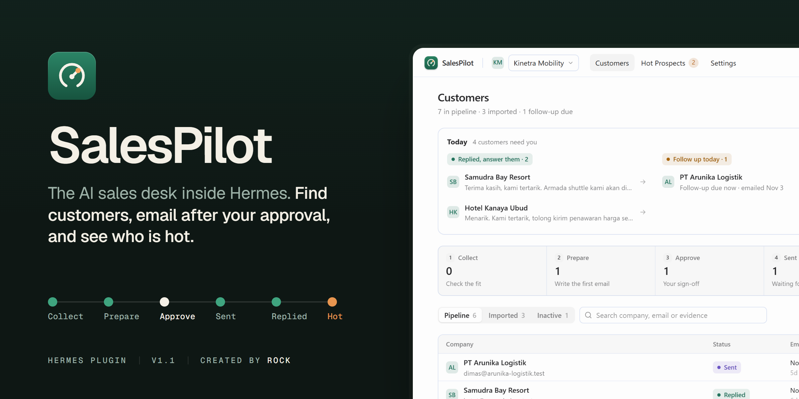
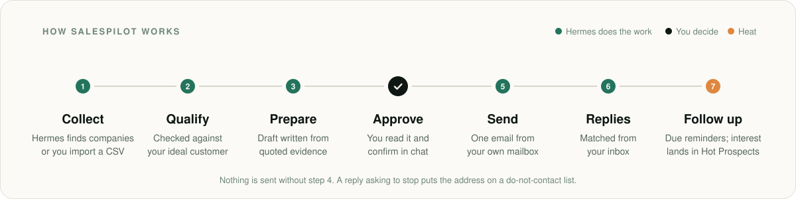
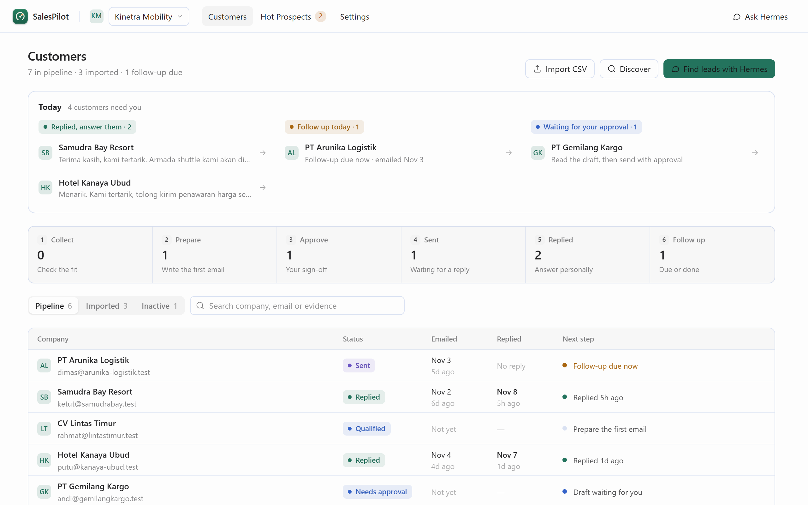
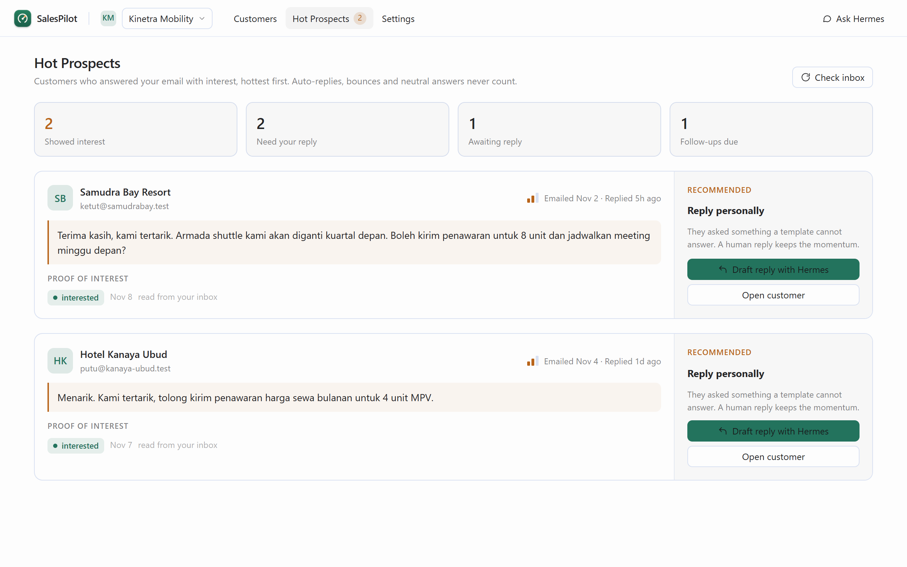
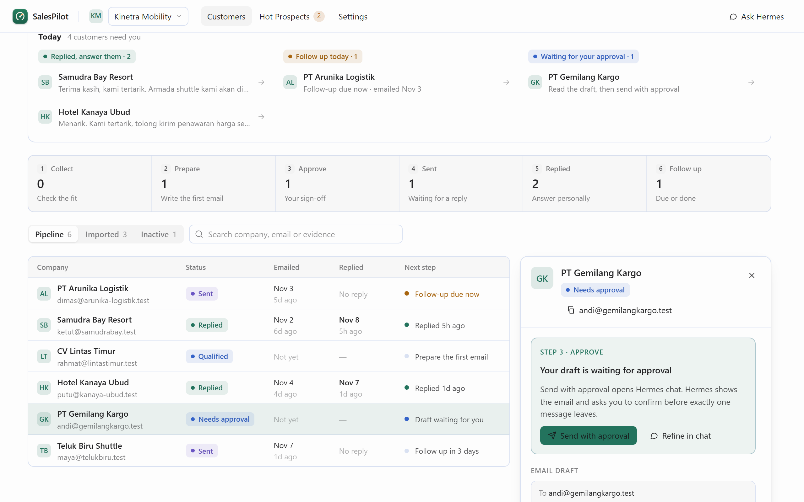
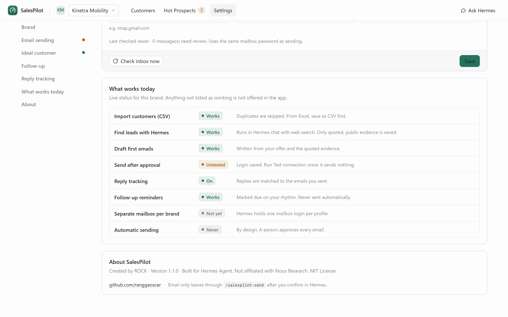

<p align="center">
  
</p>

# SalesPilot for Hermes

**The AI sales desk inside [Hermes Agent](https://hermes-agent.nousresearch.com).** Find customers,
send outreach only after you approve it, see who replied, and know who to follow up today.

Hermes is the brain that does the work: searching, researching, writing. SalesPilot is the workspace
where you see your customers, your progress and the decisions that are yours to make.

<sub>Created by **ROCK** · MIT License · v1.1 · Built for Hermes Agent, not affiliated with Nous Research.</sub>

<p align="center"></p>

## Why it exists

Small B2B teams lose deals in the gaps: a list that never gets worked, an email nobody followed up, an
interested reply buried in an inbox. SalesPilot keeps the whole loop on one page and keeps a person in
charge of every email that leaves.

- **Start from what you have.** Import a CSV, or ask Hermes to find companies that match your ideal
  customer. Duplicates are skipped; every lead keeps the quote that made it a lead.
- **Never send by accident.** Drafts wait for you. "Send with approval" opens Hermes chat, shows the
  exact email, and asks you to confirm before exactly one message leaves your own mailbox.
- **See what happened.** Every customer shows when they were emailed, when they replied and what they
  said, and the next step — in plain words.
- **Spend time on the right people.** Hot Prospects lists only customers who answered with interest,
  with their own words as proof and a recommended next move.

## A quick tour

| Customers | Hot Prospects |
| --- | --- |
|  |  |
| **Today** tells you who needs you: replies to answer, follow-ups due, drafts waiting for approval. The journey shows where every customer is. | Interested replies only — auto-replies, bounces and neutral answers never count. Hottest first. |

| Approve before sending | Honest settings |
| --- | --- |
|  |  |
| Open any customer to see the draft, the evidence, the full activity history and the one next step. | "What works today" shows live status for the active brand: what works, what needs setup, what is not supported. |

More: [CSV import](docs/screenshots/v1.1/05-import.png) · [Settings](docs/screenshots/v1.1/06-settings.png) ·
[Dark theme](docs/screenshots/v1.1/08-dark.png) · [Narrow window](docs/screenshots/v1.1/09-narrow.png).
All screenshots use [fictional data](docs/screenshots/README.md).

## Set up in five minutes

1. **Install and enable** the plugin (see [Install](#install)), then open **SalesPilot** in the Hermes
   sidebar.
2. **Describe your business** in Settings → Brand: what you sell and who you sell to.
3. **Define your ideal customer**: industries, locations and the job titles that buy.
4. **Connect your email** in Settings → Email sending (your provider's SMTP server, sender name and
   address). Put the mailbox username and password in Hermes: *Settings → Plugins → SalesPilot*. They
   are stored by Hermes, never by SalesPilot. Review and confirm **Save sender** before testing.
   Native Hermes Settings take precedence over the wizard. Click **Test connection** — it signs in once and sends
   nothing. Prefer to look around first? Choose **research-only mode**; nothing can be sent.
5. **Add customers**: *Import CSV*, or *Find leads with Hermes*.

The Getting started card on the Customers page tracks these steps and disappears when you are done.
Optional: add your incoming mail server under **Reply tracking** so replies are matched automatically.

## Safety by design

| Rule | How it is enforced |
| --- | --- |
| A person approves every email | Email leaves only through `/salespilot-send <draft>` inside Hermes chat, after Hermes asks and you choose *send*. No tool call and no button can send. The desktop API has no send route. |
| Brands never mix | Each brand has its own customers, profile and ideal customer. Actions from the page are checked against the active brand. |
| "Stop" means stop | A reply asking to stop puts the address on the brand's do-not-contact list; drafts and sends to it are refused. |
| No bulk blasts | At most 5 emails a day per brand, and the same address is not emailed twice within 7 days. |
| Credentials stay in Hermes | SMTP login is read through Hermes' secret store. It is never written to SQLite, config files, logs or the page. |
| Honest about delivery | "Sent" means your mail server accepted it, not that it reached an inbox. Replies count only when they answer an email SalesPilot sent. |
| Your data stays local | Everything lives in `<HERMES_HOME>/plugin-data/hermes-salespilot/`. No telemetry. |

## What works today

| Capability | Status |
| --- | --- |
| Import customers from CSV (with duplicate detection) | ✅ Works. From Excel, *Save As → CSV* first. |
| Find leads with Hermes (web search, quoted evidence only) | ✅ Works in Hermes chat. |
| Qualify against your ideal customer, draft first emails | ✅ Works. |
| Send one email after approval, from your SMTP mailbox | ✅ Works once your mailbox is connected. |
| Match replies from your inbox (IMAP, read-only) | ✅ Works once Reply tracking is set up. |
| Follow-up reminders on your rhythm | ✅ Works. Reminders only — follow-ups are written with Hermes and approved like any email. |
| Several brands in one workspace | ✅ Works. Switch from the header. |
| A separate mailbox per brand | ⛔ Not yet. Hermes stores one mailbox login per profile, so all brands send through it. |
| Excel (.xlsx) files directly | ⛔ Not yet. Save as CSV. |
| Gmail / Outlook sign-in (OAuth) | ⛔ Not yet. Use the provider's SMTP/IMAP with an app password. |
| Automatic or bulk sending | 🚫 Never, by design. |

Reply understanding uses keyword rules in English and Indonesian. An unclear reply is kept for your
review instead of being guessed.

## Install

```bash
hermes plugins install <git-url> --no-enable
hermes plugins enable hermes-salespilot --no-allow-tool-override
```

Then open Hermes Desktop → Settings → Plugins → **Rescan** (or restart the app) and choose
**SalesPilot** in the sidebar. Requires Hermes `>= 0.23.0`.

### Updating from 1.1.0

Version **1.1.1** removes model access to SMTP transport and sender configuration. Existing SQLite
mail settings have no reliable operator provenance, so they are retained but **not used for login**
until you review and confirm them again in the Desktop wizard. Alternatively configure transport in
Hermes Settings; those values always take precedence, with no fallback to a legacy host. Customer
and message records are unchanged. IMAP now requires certificate- and hostname-verified TLS;
plaintext IMAP is refused before reading credentials. See [security patch notes](docs/SECURITY-1.1.1.md).

Copying this directory to `~/.hermes/plugins/hermes-salespilot` and enabling it also works. Do not copy
the plugin into the Hermes source tree. `hermes plugins remove` deletes the install tree and keeps your
data directory.

<details>
<summary><b>For developers</b> — checks, tests, tools, disclosure</summary>

### Checks

```bash
hermes plugins validate . --install-deps
hermes plugins doctor . --ci
python -m unittest discover -s tests -t . -v      # needs Hermes on PYTHONPATH for two manifest tests
node --test tests/desktop/plugin-lifecycle.test.mjs tests/desktop/select-dropdown.test.mjs
```

No Python dependencies are declared. The desktop page is one ES module (`desktop/plugin.js`) with no
build step.

### Layout

| Path | Role |
| --- | --- |
| `desktop/plugin.js` | The SalesPilot page: Customers, Hot Prospects, Settings |
| `dashboard/plugin_api.py` | Desktop REST routes (read views, import, qualify, draft, inbox check). No send route. |
| `desk_actions.py` | Brand-scoped write actions behind those routes; every response carries `sent: false` |
| `tools.py`, `commands.py` | Hermes tools and the `/salespilot-send` slash command |
| `inbox.py`, `followstate.py` | Reply matching, intent and follow-up state |
| `assets/` | App icon, brand sheet, marketplace cover and their HTML/SVG sources |

### Tools

| Tool | Job |
|---|---|
| `salespilot_onboard_business` | Save a business profile, or quote one from an authorized page |
| `salespilot_import_customers` | Import an authorized CSV with a column mapping |
| `salespilot_qualify_lead` | Score a prospect from cited evidence |
| `salespilot_research_opportunity` | Extract quotes from permitted public text |
| `salespilot_draft_outreach` | One email draft per lead, idempotent |
| `salespilot_plan_followups` | Dated next step. Never a send |
| `salespilot_report` | Counts, evidence, next actions |
| `salespilot_request_approval` | Records an approval decision. Does not transmit |
| `salespilot_configure_mail` | Status, check the operator-configured connection, or suppress an address; cannot change transport or sender |
| `salespilot_mission`, `salespilot_pipeline` | Discovery missions and pipeline actions |

Bundled skill: `hermes-salespilot:salespilot`.

### Disclosure

- **Network:** SMTP connection checks authenticate only to the operator-configured server without sending.
  Sending happens only inside `/salespilot-send` after you approve. IMAP to your
  mail server, read-only, only when Reply tracking is configured and you check the inbox. Fetching an
  authorized public URL during onboarding/research (proxy variables abort the fetch; the validated IP
  is pinned). Web search goes through Hermes' own search tool.
- **Credentials:** `SALESPILOT_SMTP_USERNAME` / `SALESPILOT_SMTP_PASSWORD`, read only through
  `agent.secret_scope`. SalesPilot never reads `.env`, `auth.json` or another tool's login.
- **Files:** writes only inside its Hermes plugin data directory.
- **Shell commands, background processes, telemetry:** none.

</details>

## Credits

Designed and built by **ROCK** ([github.com/ranggaoscar](https://github.com/ranggaoscar)) for the Hermes
plugin ecosystem. MIT License.
